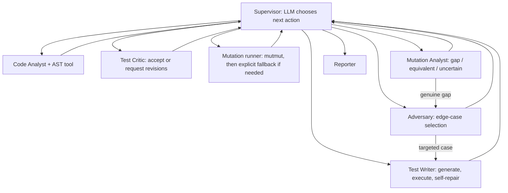

# Mutation-Guided Test Suite Generator

A multi-agent system that creates pytest tests for a Python function, executes them, runs mutation testing, classifies surviving mutants, and routes back for targeted revisions. The project uses LangGraph for stateful routing and the Anthropic Messages API for agent decisions.

> **Important:** subprocess timeouts and environment-variable filtering are defense-in-depth, not a complete sandbox. Do not expose this prototype to arbitrary untrusted code until P4 adds and validates isolated Docker execution (restricted capabilities, no network, resource limits, read-only filesystem, and no secrets in the runner environment).

## Quick start

```bash
python -m venv .venv
# Windows: .venv\Scripts\activate
# macOS/Linux: source .venv/bin/activate
pip install -r requirements.txt
cp .env.example .env   # Windows PowerShell: Copy-Item .env.example .env
# Add ANTHROPIC_API_KEY to .env; keep .env out of Git.
python run.py --file examples/sample_function.py --function clamp
```

The first run appends genuine agent events to `trace.jsonl`. Do not edit or fabricate this trace. It is append-only across runs, and each record contains a `run_id` to separate runs.

Run the API locally:

```bash
uvicorn api.main:app --reload
```

Open `http://127.0.0.1:8000/docs` and submit a `POST /generate` request, for example:

```json
{
  "source_code": "def clamp(value, lower, upper):\n    if lower > upper:\n        raise ValueError('lower must not exceed upper')\n    if value < lower:\n        return lower\n    if value > upper:\n        return upper\n    return value",
  "function_name": "clamp",
  "request_notes": "Clamp to the inclusive interval; reject lower > upper.",
  "max_rounds": 3
}
```

Without `ANTHROPIC_API_KEY`, limited deterministic fallbacks are used for local smoke tests. They are deliberately identified as fallbacks in the trace/report and are **not** evidence of full agentic behavior. Semantic test generation and supervisor choices require the API key.

## Architecture



The Supervisor is the only router. Agent nodes return state updates and append real trace events. Legal actions are constrained by the current state, but the LLM chooses among the allowed actions when configured. The local no-key path uses an explicitly logged fallback choice.

## Agent responsibilities

| Agent | File | Responsibility |
|---|---|---|
| Supervisor | `agents/supervisor.py` | Selects the next legal action, explains decisions, replans after failures, and decides when to stop. |
| Code Analyst | `agents/code_analyst.py` | Uses `ast_parser.py`, estimates complexity, and identifies branches, parameters, and risks. |
| Adversary | `agents/adversary.py` | Chooses edge cases and targets gaps highlighted by the Mutation Analyst. |
| Test Writer | `agents/test_writer.py` | Generates tests, runs them, and self-repairs failed generated modules. |
| Test Critic | `agents/test_critic.py` | Challenges weak assertions and requests specific revisions. |
| Mutation Analyst | `agents/mutation_analyst.py` | Classifies surviving mutants as likely gaps, likely equivalent, or uncertain. |
| Reporter | `agents/reporter.py` | Produces a factual run report with limitations and unresolved gaps. |

## Team ownership from the onboarding brief

- **P1 — Core Lead:** `core/*`, Supervisor, `api/main.py`, orchestration/design diagram.
- **P2 — Analysis:** Code Analyst, `tools/ast_parser.py`, Adversary, Reporter, synopsis and schemas.
- **P3 — Generation & Quality:** Test Writer, Test Critic, `tools/pytest_runner.py`, `tests/`, CI, README and agent-role documentation.
- **P4 — Execution & Deployment:** Mutation Analyst, `tools/mutmut_runner.py`, sandbox hardening, Dockerfile and deployment; capture a real deployed trace.

Use one branch per workstream (e.g. `p2/code-analyst`), small commits, and pull requests. Register each contributor's GitHub username before committing, and never commit `.env` or trace entries edited by hand.

## Tests and CI

```bash
python -m pytest -q
```

CI checks imports, AST analysis, pytest-runner behavior, and graph routing helpers. The end-to-end LLM/mutation demo needs a configured key and the supported tools installed.

## Known MVP limitations

1. Mutation score parsing from mutmut CLI output is best-effort because mutmut output can vary by version; raw output is preserved in the result.
2. When mutmut fails or times out, the Supervisor routes a recovery attempt; the mutation node then runs a reduced token-mutation fallback labelled `fallback_token`.
3. The heuristic offline critic is not a substitute for the LLM critic.
4. The temporary subprocess runner is not a security boundary. Complete isolated execution and resource/network restrictions before public deployment.
5. Deployment target (Render or Railway) remains a team decision.
