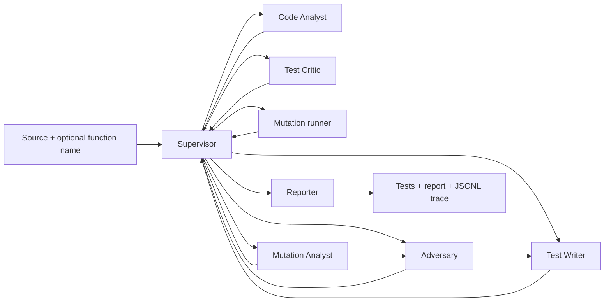

# System Design

## Design objective

Generate pytest tests for a Python function, execute the tests, estimate their fault-detection power through mutation testing, and iteratively target surviving faults. The system must preserve evidence of the decisions it actually made.

## Orchestration pattern

The implementation uses a **supervisor-worker graph with a shared blackboard and feedback loops**. `GeneratorState` in `core/state.py` is the blackboard. Each worker receives that state and writes typed result fields. After each worker, control returns to the Supervisor. The `legal_actions` function constrains safe, valid destinations based on progress and retry limits; when an API key is available, the Supervisor's LLM selects one destination and gives a rationale. The no-key route is a clearly traced deterministic fallback.

## Agent I/O contracts

| Agent | Reads | Writes | Exit / replan signal |
|---|---|---|---|
| Supervisor | all status summaries, legal action list, errors | `next_action`, `decision_reason` | legal next action; reporter stops the graph |
| Code Analyst | source, optional function name, request notes | `analysis` with AST facts and model notes | parse errors are recorded and route to Reporter |
| Adversary | analysis, existing edge cases, mutation analysis/results | `edge_cases`, `needs_regeneration` | provides targeted cases when true gaps exist |
| Test Writer | source, analysis, edge cases, critic/mutation feedback | `generated_tests`, `pytest_result`, reset critic/mutation feedback | failed pytest triggers up to two in-node repair attempts |
| Test Critic | source, generated tests, pytest result, edge cases | `critic_review` | rejection can send the run back to Test Writer |
| Mutation runner | source, tests, timeout config | `mutation_result`, round/attempt counters | tries mutmut; if it fails, runs a labelled token-mutation fallback |
| Mutation Analyst | survivors, tests, source analysis | `mutation_analysis` | genuine gaps may route to Adversary; uncertain cases are reported |
| Reporter | all result fields and errors | `report` | terminal graph node |

## JSONL trace

`core/trace.py` appends one JSON object per event containing a UTC timestamp, `run_id`, agent name, event type, and payload. Events are written by the executing process when they occur; trace files must not be handcrafted. The run identifier separates multiple runs in a shared append-only trace file. Before submission, run the deployed system and preserve a real trace alongside the matching source revision.

## Error handling

The AST tool rejects missing or ambiguous top-level function selections. The pytest and mutmut tools enforce subprocess timeouts and return structured statuses. If mutmut exits non-zero or times out, the error status is returned to the Supervisor. The Supervisor decides whether to retry or stop; a recovery retry uses a small in-house token mutation sweep identified as `fallback_token`. Raw mutmut failure context is retained. The final report must make any fallback or uncertainty explicit.

## Security considerations

A temporary working directory, environment filtering, and subprocess timeout are not a sufficient security boundary for hostile Python. The public deployment must isolate executions in a separate restricted container with no network access, no inherited secrets, read-only base filesystem, dropped capabilities, and CPU/memory/process limits. The host API container should not execute attacker-controlled source directly. This is a required deployment hardening task, not a completed property of the starter implementation.

## Technology choices

- **LangGraph:** graph state and conditional routing between nodes.
- **OpenAI Responses API:** structured decisions for agent tasks and supervisor routing.
- **Python AST:** source inspection without importing or executing the target function.
- **pytest:** evaluates generated tests in a child process.
- **mutmut:** primary mutation-testing engine; a separately labelled fallback is used on operational failure.
- **FastAPI/Pydantic:** HTTP input validation and interactive API docs.
